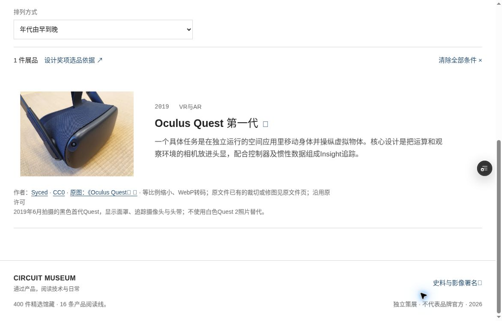
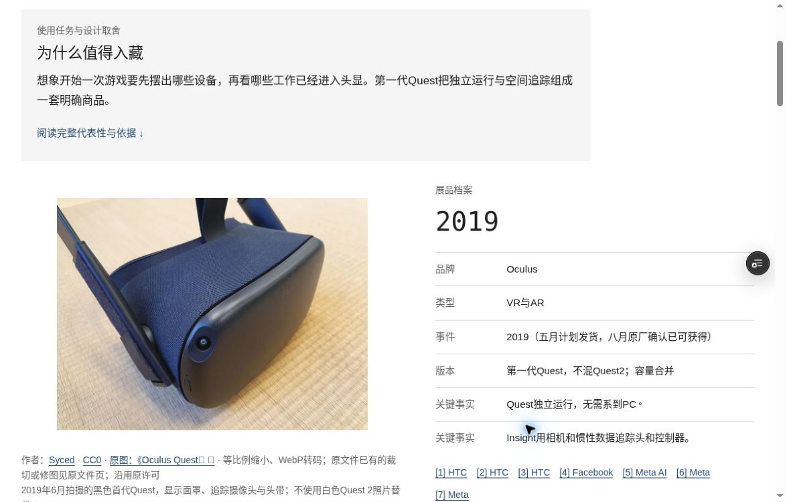
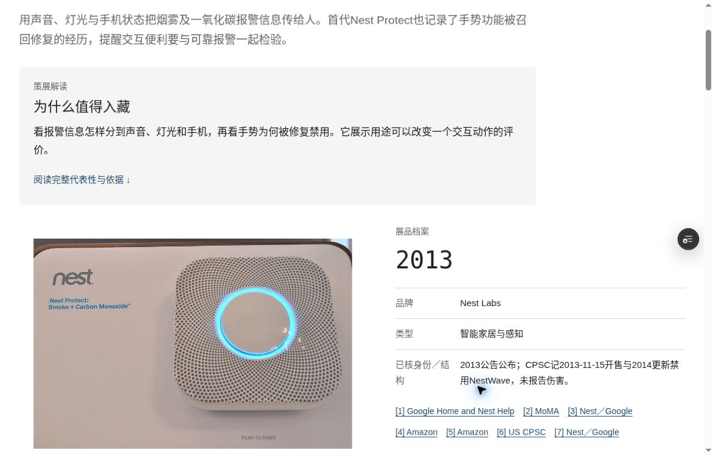

# Circuit Museum

[English](README.md) | [简体中文](README.zh-CN.md)

See the [development and maintenance history](DEVELOPMENT_HISTORY.en.md) for dated, commit-backed updates.

Circuit Museum is a static digital museum about real consumer-electronics products and how their design, technology, and everyday use have changed over time. It combines an editorial catalog with sourced product histories. The website interface and exhibit articles are primarily in Chinese; this README provides English project documentation.

## Current collection

The current source-data snapshot, checked on 2026-10-21 UTC, contains:

- 400 product exhibits and 744 collection source records.
- 16 thematic chronicle reading lines, 409 nodes, and 729 chronicle source records.
- 139 exhibits with a primary photograph and 261 without one. The 140 image records also include one internal-detail image.
- Five video links for viewing on their original publisher pages.

Source counts enumerate records, so a website may appear more than once. Each citation records the supported claims, verification depth, and applicable scope. Earlier references to 40 exhibits and October 3–4 test runs describe historical snapshots.

## What it does

- Presents a homepage, searchable collection, individual exhibit articles, product chronicles, and supporting curatorial pages.
- Combines keyword, category, and decade filters with chronological sorting and shareable URL state.
- Connects dated chronicle nodes to catalog exhibits and nearby source references.
- Keeps product context, design, use, significance, and limitations alongside paragraph-level references.
- Preserves image attribution and usage notes, and marks photographs that await verification for the exact model.

## Development preview and screenshots

[Open the protected development preview](https://circuit-museum-a5e6r7np6-lighthousexy-6060s-projects.vercel.app) for review and browser checks. Vercel sign-in is required. This candidate has its own build and release status. It displays the existing CC0 photographs for `nest-protect-1` and `oculus-quest-2019`, two of the 139 catalog photographs; the remaining media requires separate restoration and rights review.

These unedited screenshots were captured in Cloud Chrome on 2026-10-21 from the protected two-photo development preview. See [screenshot provenance and photo credits](docs/screenshots/circuit-museum/ATTRIBUTION.md) for the original authors, files, CC0 terms, and conversion notes.

### Collection filter: Oculus Quest



### Exhibit detail: Oculus Quest



### Exhibit detail: Nest Protect



## Run locally

Use Node.js 22 or later. The ordinary static build runs locally with Node.js alone. Run the commands below directly; the repository uses Node.js built-ins and ships without a dependency lockfile.

```sh
npm run build
npm run dev
```

Open <http://127.0.0.1:4173/>. Set `PORT` to use another local port. Output is written to `dist/`; rebuild after editing data or styles.

```sh
npm run lint
npm test
```

Build before testing because several tests inspect `dist/`. `lint` performs Node.js syntax checks. Media tests compare the current Atari image attribution and a tracked Samsung photograph with its recorded SHA-256. Revised wording baselines live in `tests/fixtures/writing-style/`; the original evidence remains available. Historical test scope and limits are recorded in [docs/test-results.md](docs/test-results.md).

The commands above build and check this repository. The protected preview uses a separate candidate with its own restricted-media and release tooling. Optional image-maintenance scripts require separately supplied Sharp; historical browser scripts use separately supplied Playwright and Chrome.

## Data and maintenance

- [docs/collection.json](docs/collection.json): editable exhibit catalog, editorial sections, source IDs, paragraph references, and related exhibits.
- [src/collection.json](src/collection.json): generated catalog used by the site; edit the source data and rebuild it through [scripts/import-collection.mjs](scripts/import-collection.mjs).
- [docs/chronicles.json](docs/chronicles.json): thematic reading lines, dated nodes, exhibit links, and a separate source registry.
- [src/image-overrides.json](src/image-overrides.json): actual image-file mappings, creators, source pages, licenses, and conversion notes.
- [docs/media-register.json](docs/media-register.json): historical media candidates and video links. Actual images and their per-file reuse terms are registered in `src/image-overrides.json`.
- [docs/implementation.md](docs/implementation.md): implementation history.

For corrections, identify the stable exhibit slug, exact model, original source, supported claim, checked date, and any limitations. Keep editorial interpretation separate from manufacturer claims and individual observations. Preserve stable IDs and the site's existing numbering rules.

Add an image after checking its exact source file, model, terms, attribution, and permitted modifications. A photograph must match the exhibit model and carry verified reuse permission. Keep videos as links to their publishers and keep contributions free of credentials and private collaboration records. After code or data changes, run a build, lint, and then tests, and report the actual environment and results.

## License and release status

The project-owned original software and original technical documentation are licensed under the [MIT License](LICENSE), allowing commercial use, modification and redistribution with the required copyright and permission notices. See [LICENSE-SCOPE.md](LICENSE-SCOPE.md) and the [path inventory](docs/licensing/PATH-SCOPE.json) for the exact scope.

The original 400-exhibit curatorial/source databases, third-party code and dependencies, images, audiovisual material, screenshots, fonts and hardware retain their existing rights. Their CC BY, CC BY-SA, CC0, public-domain, Unsplash or vendor-specific terms apply where recorded. See [third-party rights](docs/licensing/THIRD-PARTY-NOTICES.md). Reuse permission follows the recorded original terms. Package metadata points to the scope document because this repository contains mixed-license content.

Current release status: the repository is public, the linked candidate is a protected development preview, and production release and external community adoption await confirmation. Media reuse follows the per-file terms above.
