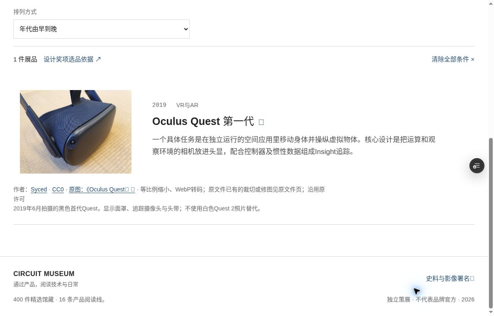
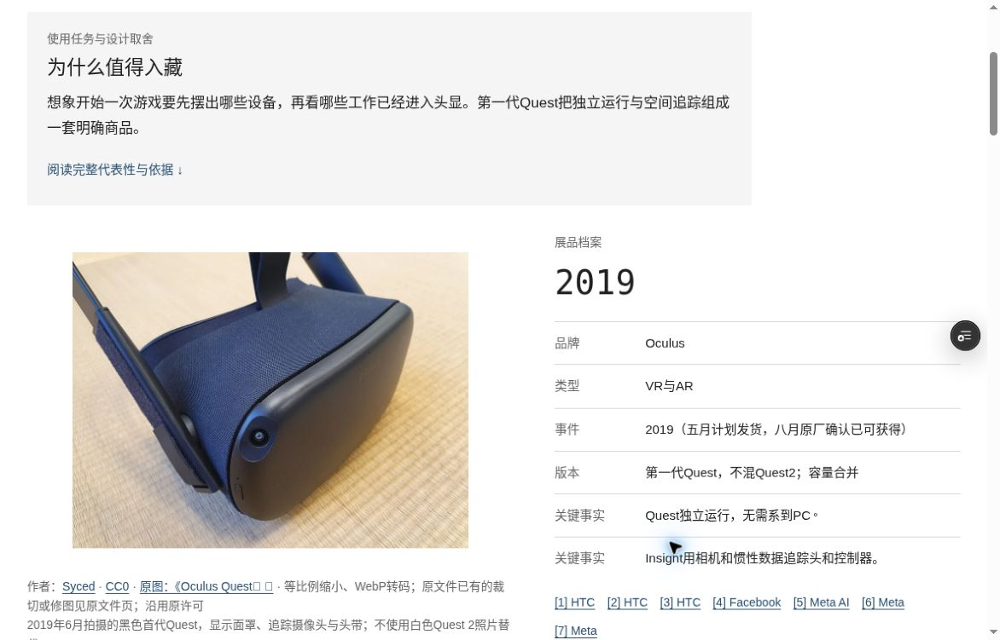
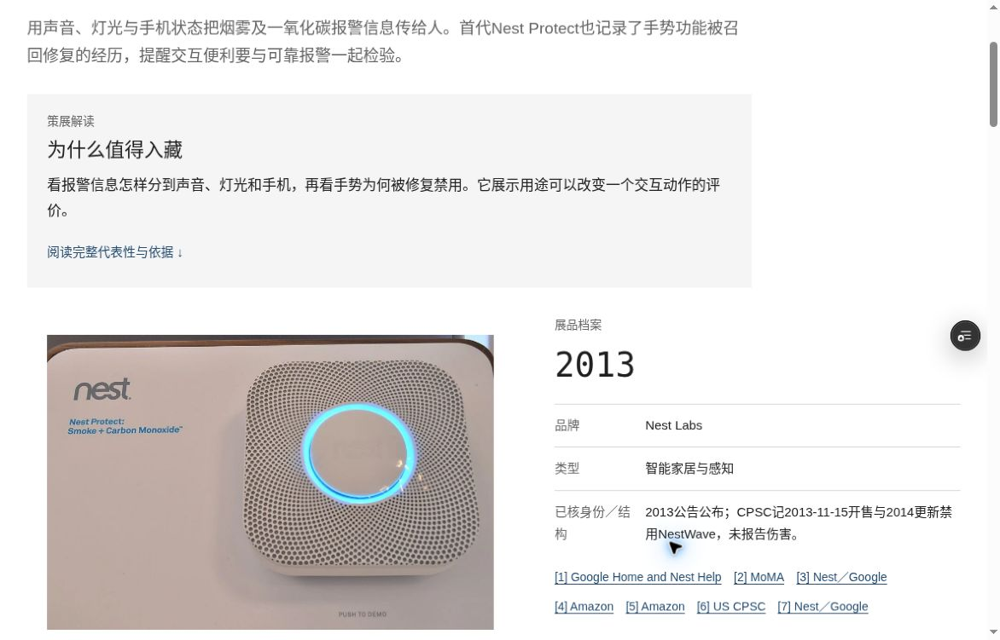

# Circuit Museum · 赛博电子博物馆

[简体中文](README.md) | [English](README.en.md)

项目更新记录：[开发与维护记录](DEVELOPMENT_HISTORY.md)（按真实 Git 日志与差异整理）。

一座关于真实电子产品设计、技术与生活变化的线上博物馆，收录40件独立产品。首页介绍博物馆并引导馆藏阅读；独立的“产品编年史”覆盖手机、电脑、手表、手环、耳机五条发展脉络，共29个有来源的历史节点。保留TPS-L2、2006年第一代MacBook和iPhone 4。

## 开发预览截图

以下为 2026-10-21 云端实际截取的受保护开发预览，仅恢复 Nest Protect 与 Oculus Quest 两张已核实的 CC0 展品图片；不代表正式上线、全馆图片已恢复或全馆素材清权。图片作者、原文件页及转换说明见[截图来源与署名](docs/screenshots/circuit-museum/ATTRIBUTION.md)。

### 馆藏筛选：Oculus Quest



### 展品详情：Oculus Quest



### 展品详情：Nest Protect



## 本地查看

使用 Node.js 22 或更新版本，无需安装生产依赖。

```sh
npm run build
npm run dev
```

打开 http://127.0.0.1:4173。`PORT=其他端口 npm run dev` 可更换端口。构建输出在 `dist/`；修改来源数据或样式后重新运行 build。当前交付仅本地预览，未部署到公共网络。

## 功能

- 导航顺序为：首页 `/` → 馆藏 `/exhibits/` → 产品编年史 `/chronicles/` → 关于 `/about/`。
- 独立首页介绍博物馆，以三件指定产品作为起读精选，提供馆藏主入口、产品类型链接与五类编年史入口。
- 产品编年史保留五类独立导言、变化线索、年代节点和紧邻来源；20个真实馆藏节点的摘要与对应展品同步。
- 40个详情页均提供代表性、背景、设计、实际使用与局限五节长文，带页内阅读目录和各节引用；2026年产品标为「当代观察」。
- 编年史详情往返恢复品类与节点，分享地址在新会话中可用。
- 产品类型、年代、关键词组合筛选；升降序排列；条件写入 URL。
- 支持中文品牌别名、型号空格和连字符搜索；空结果提示与重置。
- 从详情返回馆藏时恢复筛选条件和浏览位置。
- 历史背景明确区别于馆藏产品；相关展品和逐件来源署名；旧 `/timeline/` 转至编年史。
- 5 个真实影像外链，3 件展品的内部观察，缺少资料时不显示空模块。
- 手机和平板布局、键盘焦点与跳转、图片失败后的文字回退。

## 内容与图片范围

40 件产品中，33 件已配真实实物照片；其余 7 件明确显示「实物照片待补」，仍有完整文字与来源。另有 1 张 HP-35 内部细节照片。所有实际展示照片的作者、许可、原始页面和转换说明保存在 `src/image-overrides.json`，并显示在页面中。

尚无实物照片：SP/3、Pulsar P1、DynaTAC 8000X、Kindle 第一代、iPad 第一代、13英寸 MacBook Air M5、Smart Band 11 Active。

影像使用原发布页面链接，未下载、嵌入或自动播放；未验证访客网络下的第三方视频播放。内部观察覆盖 iPhone 4、Steam Deck LCD 和 HP-35；前两项不转载拆解图片。

正文核查记录见 `docs/evidence/description-content-review.json`。部分早期资料仅核到原机构索引，或采用可读的原手册转录镜像；当代型号核对官网正文及条件说明。代表性为策展解读，厂商表述与单件体验没有被推广为群体口碑或长期表现。

## 维护入口

- `docs/collection.json`：策展正文、分类、关联展品与来源。
- `docs/media-register.json`：编辑登记及视频入口。
- `src/image-overrides.json`：实际使用的照片与许可，以具体文件为准。
- `docs/chronicles.json`：正式五类编年史节点、日期口径与来源。
- `docs/chronicles-design.md`、`docs/chronicles-review.md`：编年史视图的设计来源与此前策展/视觉验收；独立首页按2026-10-04的用户请求新增。
- `scripts/import-collection.mjs`：将资料导入生成数据 `src/collection.json`。
- `scripts/build.mjs`、`src/style.css`、`src/app.js`：页面、样式与交互。

图片已经随项目提供，普通构建无需联网或图像处理库。新增图片时，先核对具体型号及文件许可，再使用 `scripts/download-images.mjs`；维护脚本需要 Sharp，接受库路径作为第一个参数，跳过已有文件。

## 检查

```sh
npm run build
npm run lint
npm test
```

`lint` 是 Node 语法检查，项目为原生 JavaScript，未使用 TypeScript。浏览器回归使用外部 Playwright 与 Chrome，不增加站点生产依赖：

```sh
node tests/browser.mjs /absolute/path/to/playwright /absolute/path/to/chrome
```

运行浏览器回归前需启动本地预览。2026-10-04的构建、7个文件语法检查、8项单元测试和20项浏览器检查均通过，覆盖独立首页、馆藏长文及编年史入口。结果见 `docs/evidence/browser-results.json`，截图见 `docs/evidence/`。2026-10-03的无脚本导航、⌘点击及当代来源专项核查保留为补充证据，本次未重跑；具体范围与限制见 `docs/test-results.md`。


## 私有仓库同步说明（2026-10-17）

本仓库同步本地现有源码与必要资源，不代表重新部署或重新验收。上文40件等说明是早期记录；当前 `docs/collection.json` 与 `src/collection.json` 的馆藏为400件，图片/版权以当前记录为准。

使用 Node.js 22+。本项目没有第三方生产依赖，未发现既有锁文件；未为上传安装依赖或生成锁文件。启动：`npm run build` 后 `npm run dev`；已有检查命令是 `npm run lint`、`npm test`，此次未执行。`dist/` 可由构建生成，不提交。图片署名与许可随资源保留，第三方图片不因软件 MIT 许可获得额外转载许可。截图、下载候选、缓存和运行日志不提交。未开启 GitHub Pages。

## 许可证

本项目原创软件代码及原创技术文档按[MIT 许可证](LICENSE)授权，允许商业使用、修改与再分发，须保留版权及许可声明。具体文件与边界见[许可范围](LICENSE-SCOPE.md)和[路径清单](docs/licensing/PATH-SCOPE.json)。

该授权不是整个网站或全部馆藏素材的统一许可：400 件原始策展/数据库内容、第三方代码与依赖、字体、图片、影音、截图及硬件文件保留各自权利和条款。图片署名、原始来源、转换记录及许可继续有效，视频仍仅为原发布页外链；详见[第三方权利说明](docs/licensing/THIRD-PARTY-NOTICES.md)。本次许可调整不改变仓库可见性、网站功能或部署状态，也不代表完成素材清权或提交申请。
